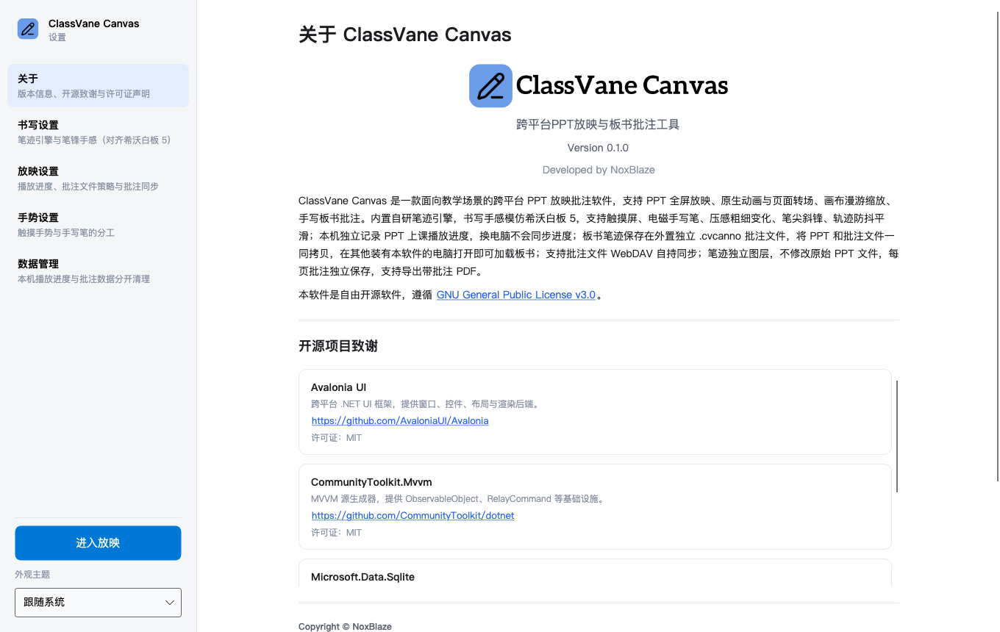
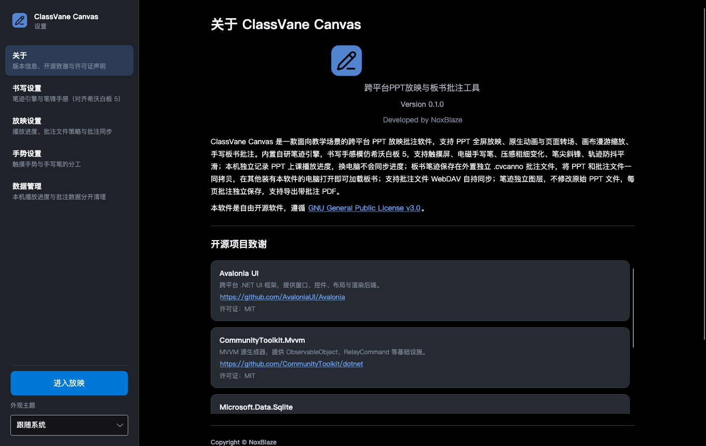
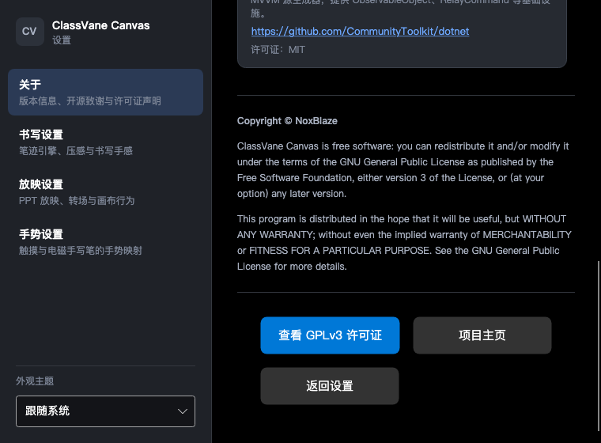
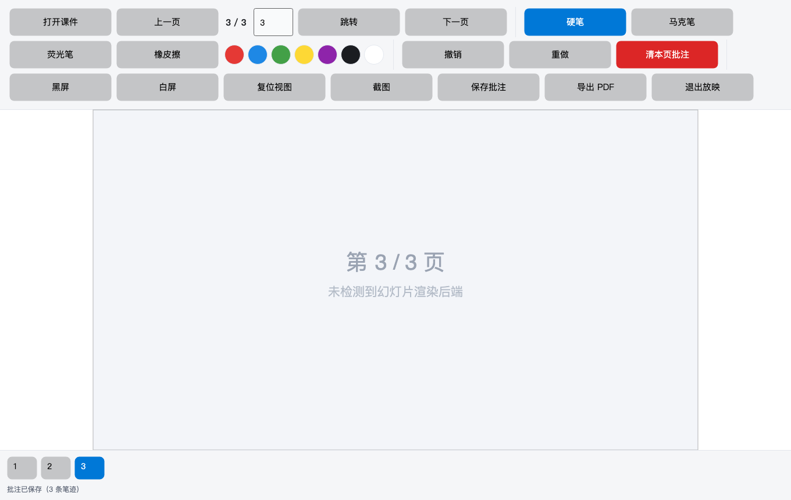
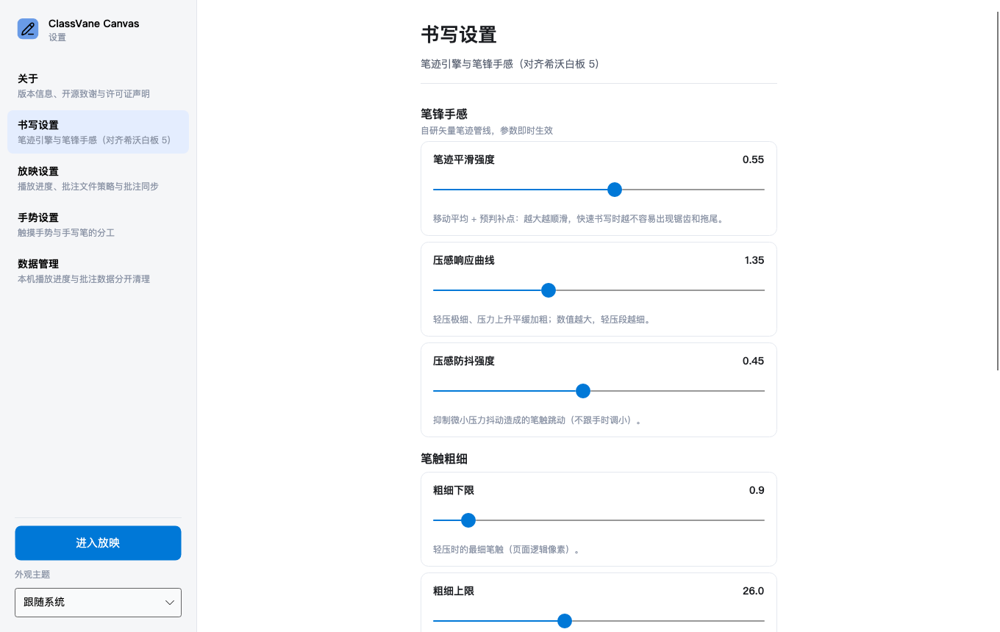
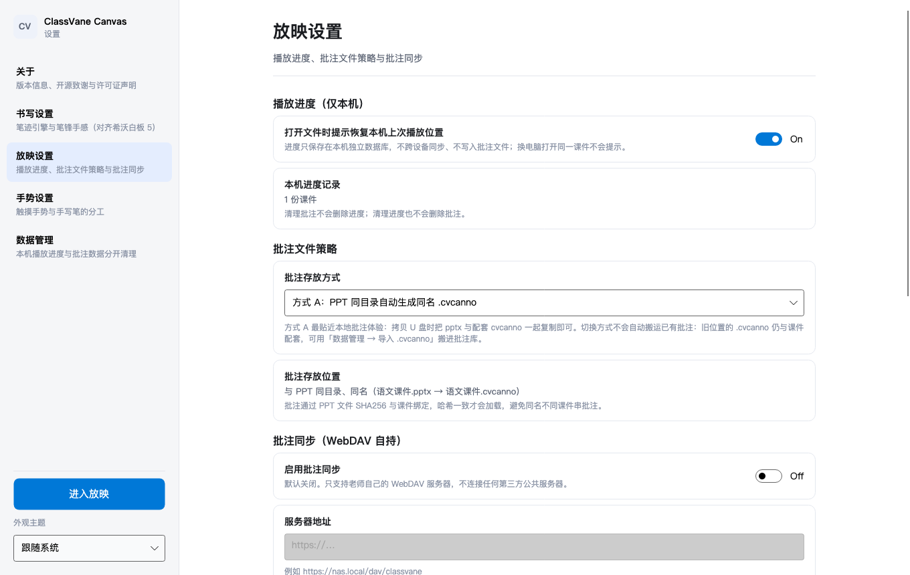
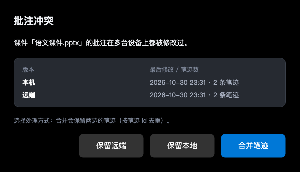

# ClassVane Canvas

跨平台 PPT 放映与板书批注工具 · Avalonia UI + C# · Windows / macOS / Linux

- 开发者：NoxBlaze
- 许可证：GPL-3.0-or-later（见仓库根目录 [NOTICE](NOTICE)）

> 本仓库当前实现的是**设置模块及其默认页面（关于页）**，放映、笔迹引擎等模块在后续迭代接入。

## 目录结构

```
ClassVane Canvas/
├── NOTICE                                  # 版权与第三方开源声明（随安装包分发）
├── design/logo-placeholder.png             # 可选的 Logo 设计参考图（不参与编译）
├── docs/preview/                           # 关于页 / 设置页 / 放映页 / 弹窗渲染预览图
├── ClassVaneCanvas.sln
└── src/ClassVaneCanvas/
    ├── Assets/                             # Logo 预留位：把 logo.png 放到这里即可
    ├── Annotations/                        # .cvcanno 批注包读写、同目录/批注库存储、笔迹合并
    ├── Controls/                           # InkCanvas（笔迹渲染 + 输入采集 + 手势）
    ├── Export/                             # 导出带批注 PNG / PDF（自研最小 PDF 写入器）
    ├── Ink/                                # 自研笔迹引擎：压感曲线 / 平滑 / 几何 / 命中 / 撤销
    ├── Models/                             # 批注与笔迹模型、AppSettings、PlaybackProgress
    ├── Presentation/                       # 幻灯片位图来源（LibreOffice 探测式 + 占位实现）
    ├── Services/                           # 设置、主题、链接、课件指纹、弹窗、文件选择
    ├── Storage/                            # 本机播放进度 SQLite（与批注物理隔离）
    ├── Sync/                               # 批注同步：WebDAV / 同步文件夹 + 冲突检测合并
    ├── Themes/                             # 深/浅色主题资源字典 + 全局样式
    ├── ViewModels/                         # MainWindow / Presentation / Settings 各页
    └── Views/
        ├── MainWindow.axaml
        ├── Dialogs/                        # 恢复播放位置、批注冲突、确认弹窗
        ├── Presentation/                   # PresentationView（工具栏 + 画布 + 缩略图）
        └── Settings/                       # SettingsShellView、AboutView、SettingsOptionsView
```

## 两条互不干扰的数据链

| | 播放进度 | 板书批注 |
| --- | --- | --- |
| 存放位置 | 本机 `playback-progress.db`（SQLite） | 外置 `*.cvcanno`（PPT 同目录或统一批注库） |
| 匹配依据 | 课件 SHA256 | 课件 SHA256（哈希不一致拒绝加载） |
| 跨设备 | **绝不同步**，换电脑不提示 | 拷贝文件即可用；可选 WebDAV 自持同步 |
| 清理影响 | 清进度不动批注 | 清批注不动进度 |

原始 PPT 文件始终只读：不写 pptx 压缩包、不写 CustomXml、不做任何原地修改。

## 批注与同步

- **方式 A（默认）**：`语文课件.pptx` → 同目录 `语文课件.cvcanno`，拷 U 盘时一起复制即可在别的电脑加载板书。
- **方式 B**：统一批注库 `<数据目录>/annotations/<sha256>.cvcanno`，可配合 WebDAV 自持服务器同步。
- 冲突处理：保留本地 / 保留远端 / 合并笔迹（按笔迹 Id 去重、顺序稳定），默认策略可在放映设置里选。
- 同步只传输 `.cvcanno`；`playback-progress.db`、`settings.json`、`sync-state.json` 一律不参与（有断言覆盖）。

## 自研笔迹引擎

- 输入：系统原生压感、笔尖 TiltX/TiltY、输入源区分（手写笔/鼠标书写，手指默认手势，可开启手指书写）。
- 压感曲线：死区 + smoothstep + 可调指数，轻压极细、中段渐次加粗；压感低通抑制笔触跳动。
- 轨迹：去抖 → 端点锚定移动平均 → Catmull-Rom 预判补点；实时绘制额外做速度外推（跟手）。
- 笔触：硬笔（压感变宽闭合轮廓 + 圆形笔帽）、马克笔（椭圆笔锋支撑函数 → 扁平斜锋、半透明）、荧光笔（等宽描边、高透明不遮挡画面）、橡皮擦（点擦、只擦笔迹）。
- 坐标：全部在页面坐标系构建几何，由画布矩阵统一缩放平移 → 任意倍率矢量清晰、位置不变形。

## 界面预览

浅色主题（进入设置即默认展示关于页）：



深色主题（跟随全局主题自动切换）：



小屏 / 触摸布局（内容区垂直滚动，按钮组自动换行）：



完整长图见 [docs/preview/about-page-full.png](docs/preview/about-page-full.png)。

放映界面（板书画布 + 触摸友好工具栏 + 缩略图导航）：



书写设置（笔锋手感调节，参数即时生效）：



放映设置（进度提示、批注策略、WebDAV 自持同步、冲突默认策略）：



数据管理（进度与批注分开清理、批注包导入导出）：


恢复播放位置与批注冲突弹窗：




> 预览图由 Avalonia Headless + Skia 渲染生成，其中 Logo 位置为预留占位状态、幻灯片为占位画面（本机未安装 LibreOffice）。

## 设置模块

进入设置默认展示**关于**页，侧边导航：关于 / 书写设置 / 放映设置 / 手势设置 / 数据管理；底部「进入放映」切到放映界面。

设置页由「数据驱动的选项列表」渲染（开关 / 滑杆 / 下拉 / 输入 / 按钮 / 信息），新增设置项只需在对应 ViewModel 里追加一个对象，不用写新的 XAML。

## 关于页（设置默认页）

进入设置视图时默认加载并选中「关于」页，侧边导航可切换到书写设置 / 放映设置 / 手势设置。

| 规范要求 | 实现位置 |
| --- | --- |
| 页面标题「关于 ClassVane Canvas」 | `AboutView.axaml` 首行 `TextBlock.pageTitle` |
| Logo 顶部居中、静态展示、无点击 | `AboutView.axaml` 的 `Panel`（`IsHitTestVisible="False"`，无命令绑定） |
| 主标题 / 副标题 / 动态版本号 / 开发者署名 | `AboutView.axaml` + `AboutViewModel.VersionText` |
| 软件简介文本 | `AboutView.axaml` 简介段落 |
| 分割线 → 开源项目致谢（可滚动列表） | `AboutView.axaml` 的 `ItemsControl` + 独立 `ScrollViewer` |
| 分割线 → GPLv3 版权声明 | `AboutView.axaml` 版权区块（`CopyrightText` 动态绑定） |
| 底部大尺寸按钮组（查看 GPLv3 / 项目主页 / 返回设置） | `AboutView.axaml` 的 `Button.touch` 按钮组 |
| 深色 / 浅色主题自动跟随 | `Themes/AppResources.axaml` 的 `ThemeDictionaries` |
| 链接下划线、点击调用系统浏览器 | `HyperlinkButton` + `AboutViewModel.OpenLicenseCommand` / `OpenHomepageCommand` / `OpenRepositoryCommand` |
| 版本号不硬编码 | 读取程序集元数据（csproj 的 `<Version>`） |

## Logo 位置预留

界面上的 Logo 是**预留状态**，代码里已经写好占位与降级逻辑：

1. 把正式 Logo 命名为 `logo.png`，放到 `src/ClassVaneCanvas/Assets/`；
2. 项目已用 `<AvaloniaResource Include="Assets/**" />` 自动编译该目录，无需改 csproj / XAML；
3. 重新运行即可 —— 关于页 148×148 的 Logo 位、侧边栏 36×36 的图标位、窗口图标都会自动显示。

在文件就位之前，关于页显示虚线占位框（"CV / Logo 预留位"），侧边栏显示 "CV" 字标，窗口使用系统默认图标，
不会因为资源缺失而报错。加载逻辑见 `Services/AppAssets.cs`。

`design/logo-placeholder.png` 是一张可选的 Logo 设计参考图（512×512，非最终稿、不参与编译），
需要的话可以直接复制过去当临时 Logo。

## 放映与导出

- 工具栏：打开课件 / 翻页与页码跳转 / 硬笔·马克笔·荧光笔·橡皮擦 / 调色板 / 撤销·重做·清本页 / 黑屏·白屏 / 复位视图 / 截图 / 保存批注 / 导出 PDF / 退出放映。
- 手势：单指滑动翻页，双指捏合缩放 + 拖拽漫游；手写笔落笔优先书写且期间忽略触摸（手掌抑制）。
- 幻灯片渲染后端是可插拔的：检测到 LibreOffice 时用 `soffice` 把课件转成 PDF 并按页取图（接入 pdfium / mupdf 光栅化器只需传一个委托）；未检测到时画布显示占位画面，批注、手势与导出仍然可用。
- 导出：带批注 PNG（当前页）与带批注 PDF（整份课件，自研最小 PDF 写入器，无第三方依赖）。

## 构建与运行

需要 .NET SDK 7.0 或更高（推荐 8.0）。

```bash
cd "ClassVane Canvas"
dotnet restore
dotnet run --project src/ClassVaneCanvas
```

发布单文件 / 自包含产物（示例）：

```bash
dotnet publish src/ClassVaneCanvas -c Release -r osx-arm64   --self-contained
dotnet publish src/ClassVaneCanvas -c Release -r win-x64     --self-contained
dotnet publish src/ClassVaneCanvas -c Release -r linux-x64   --self-contained
```

## 新增第三方依赖时

1. 在 `AboutViewModel.Acknowledgements` 中追加一项 `ThirdPartyNotice`（名称 / 仓库链接 / 许可证）；
2. 在仓库根目录 `NOTICE` 的第三方列表中追加对应条目。

关于页列表在代码中只需追加数据，界面自动渲染。
